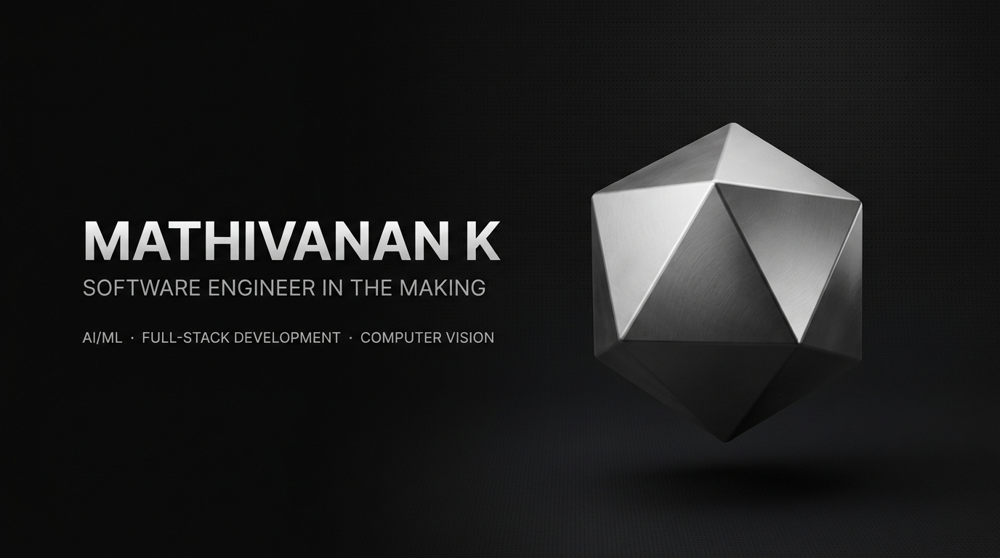

<div align="center">



<br/><br/>

# MATHIVANAN K
### Software Engineer in the Making · Applied AI · Full-Stack Systems

[](https://github.com/mathivanan01)
[](https://www.linkedin.com/)<!-- Replace with your personal LinkedIn profile URL -->
[](https://github.com/mathivanan01/leetcode-solutions)
[](mailto:mathivanan.k.dev@gmail.com)

<p align="center">
  <b>B.E. Computer Science and Engineering</b> · <a href="https://kongu.ac.in/">Kongu Engineering College</a> (2024–2028)<br/>
  Focusing on high-throughput backend services, computer vision pipelines, and intelligent multimodal interfaces.
</p>

</div>

---

### 01 / EXECUTIVE PROFILE

I am an engineering undergraduate specialized in constructing production-grade full-stack architectures, real-time event-driven systems, and practical machine learning applications. My work spans enterprise telemetry platforms with WebSocket broadcast engines, edge biometrics utilizing YOLOv8 and deep facial embeddings, and trilingual voice-to-structured-data translation pipelines powered by generative AI.

- **Systems Approach**: Prioritizing decoupled modular code, strict schema validation, type safety, and real-time observability.
- **Applied AI & Vision**: Translating machine learning research into low-latency inference pipelines (YOLOv8, dlib 128-d embeddings, Scikit-learn, XGBoost).
- **Core Engineering**: Solid grounding in operating systems internals, concurrency, algorithms, and relational data modeling.

---

### 02 / VERIFIED TECHNICAL ARSENAL

Curated technical stack verified across production repositories:

<table>
  <tr>
    <td width="22%" valign="top"><b>Languages</b></td>
    <td width="78%">
      <code>Python 3.12</code> &nbsp;·&nbsp;
      <code>Java</code> &nbsp;·&nbsp;
      <code>TypeScript</code> &nbsp;·&nbsp;
      <code>JavaScript (ES6+)</code> &nbsp;·&nbsp;
      <code>C / C++</code> &nbsp;·&nbsp;
      <code>SQL</code> &nbsp;·&nbsp;
      <code>PHP 8+</code>
    </td>
  </tr>
  <tr>
    <td valign="top"><b>AI & Computer Vision</b></td>
    <td>
      <code>YOLOv8</code> &nbsp;·&nbsp;
      <code>OpenCV</code> &nbsp;·&nbsp;
      <code>dlib (128-d Embeddings)</code> &nbsp;·&nbsp;
      <code>Scikit-learn</code> &nbsp;·&nbsp;
      <code>XGBoost</code> &nbsp;·&nbsp;
      <code>Google GenAI SDK</code> &nbsp;·&nbsp;
      <code>SMOTE-Tomek</code>
    </td>
  </tr>
  <tr>
    <td valign="top"><b>Backend & Real-Time</b></td>
    <td>
      <code>FastAPI</code> &nbsp;·&nbsp;
      <code>Flask</code> &nbsp;·&nbsp;
      <code>Node.js</code> &nbsp;·&nbsp;
      <code>Express.js</code> &nbsp;·&nbsp;
      <code>FastAPI WebSockets</code> &nbsp;·&nbsp;
      <code>Socket.io</code> &nbsp;·&nbsp;
      <code>Async SQLAlchemy</code> &nbsp;·&nbsp;
      <code>JWT & RBAC</code>
    </td>
  </tr>
  <tr>
    <td valign="top"><b>Frontend & UI</b></td>
    <td>
      <code>React 18 / 19</code> &nbsp;·&nbsp;
      <code>TanStack Start</code> &nbsp;·&nbsp;
      <code>HTML5 / CSS3</code> &nbsp;·&nbsp;
      <code>Leaflet GIS</code> &nbsp;·&nbsp;
      <code>Chart.js</code> &nbsp;·&nbsp;
      <code>Vite</code>
    </td>
  </tr>
  <tr>
    <td valign="top"><b>Databases & Storage</b></td>
    <td>
      <code>PostgreSQL</code> &nbsp;·&nbsp;
      <code>MySQL</code> &nbsp;·&nbsp;
      <code>MongoDB</code> &nbsp;·&nbsp;
      <code>SQLite</code> &nbsp;·&nbsp;
      <code>IndexedDB</code>
    </td>
  </tr>
  <tr>
    <td valign="top"><b>Infrastructure & Tools</b></td>
    <td>
      <code>Docker</code> &nbsp;·&nbsp;
      <code>Docker Compose</code> &nbsp;·&nbsp;
      <code>Git & GitHub Actions</code> &nbsp;·&nbsp;
      <code>Linux / Bash</code> &nbsp;·&nbsp;
      <code>XAMPP</code>
    </td>
  </tr>
</table>

---

### 03 / FEATURED ARCHITECTURAL SYSTEMS

#### [01] SmartCoal Governance Platform
> **Enterprise Real-Time AI Statutory Compliance & Mine Command Center**  
> *Repository:* [`mathivanan01/smartcoal-governance`](https://github.com/mathivanan01/smartcoal-governance) &nbsp;·&nbsp; *Stack:* Python 3.12, FastAPI, WebSockets, Async SQLAlchemy, Scikit-learn, Leaflet GIS, React, Docker

An enterprise-grade digital command center connecting mine sites, field officers, mine managers, and statutory authorities (DGMS) in real-time.
- **Real-Time Telemetry**: WebSocket event broker with role-based room subscriptions for multi-user coordination.
- **Intelligent Risk Engine**: Scikit-learn Isolation Forest anomaly detection for proactive hazard prevention and multi-factor dynamic risk scoring.
- **Statutory Document OCR**: Automated parsing and expiry tracking for mining licenses and contractor clearances.
- **GIS Command Grid**: Live color-coded spatial risk maps powered by Leaflet and OpenStreetMap.

```
[ Field Sensors / Mobile PWA ] ──► [ FastAPI Gateway ] ──► [ Isolation Forest Anomaly Engine ]
                                            │
                                 [ WebSocket Broker ] ──► [ Leaflet GIS Real-Time Command Center ]
```

---

#### [02] ASAMAS — Automated Student Attendance Monitoring & Analytics System
> **Edge Face Detection & 128-Dimensional Biometric Verification Pipeline**  
> *Repository:* [`mathivanan01/attendance_system`](https://github.com/mathivanan01/attendance_system) &nbsp;·&nbsp; *Stack:* Python, Flask, YOLOv8-face, dlib (`face_recognition`), OpenCV, MySQL, Chart.js

An automated biometric session tracker designed to eliminate proxy attendance in academic environments through dual-stage computer vision.
- **Dual-Model Vision**: Real-time face localization using YOLOv8-face coupled with dlib 128-dimensional facial embedding distance metrics.
- **Anti-Proxy Protection**: Euclidean distance verification with strict confidence gating and manual administrative override workflows.
- **Live Video Streaming**: Low-latency MJPEG multi-part camera stream with bounding-box overlays.
- **Analytics Dashboard**: 3-tier role-based access control (Admin, Teacher, Student) with dynamic Chart.js reporting and CSV exports.

---

#### [03] MozhiFill AI — Say It, Fill It
> **Trilingual Voice-to-Structured-Data Engine with Generative Entity Extraction**  
> *Repository:* [`mathivanan01/voice-based-form-filling`](https://github.com/mathivanan01/voice-based-form-filling) &nbsp;·&nbsp; *Stack:* TypeScript, TanStack Start, React, Google GenAI SDK, Web Audio API

A voice-first form automation system that transcribes and maps continuous conversational speech directly into structured database fields.
- **Trilingual Comprehension**: Native parsing support for English, தமிழ் (Tamil), and code-mixed Tanglish.
- **Generative Entity Extraction**: Leverages Google Gemini multimodal capabilities to extract names, contact data, dates, and locations from raw audio inputs.
- **Low-Latency Client Pipeline**: Browser-native WAV recording engine feeding streamed audio chunks directly into backend API endpoints.

---

#### [04] Clinical ASD Screening Platform & Federated IoT Simulator
> **Machine Learning Diagnostic Pipeline with Distributed Privacy-Preserving Simulation**  
> *Repository:* [`mathivanan01/autism-detection-system`](https://github.com/mathivanan01/autism-detection-system) &nbsp;·&nbsp; *Stack:* Python, JavaScript, XGBoost, SMOTE-Tomek, React

A clinical-grade screening platform for Autism Spectrum Disorder (ASD) built on sequential gradient boosting.
- **Imbalance Resolution**: Employs SMOTE-Tomek hybrid sampling to resolve class skew across adolescent and adult screening datasets.
- **Federated Architecture Simulation**: Conceptual framework modeling decentralized, privacy-preserving model updates across distributed IoT clinical nodes without centralizing raw patient records.
- **Explainable Metrics**: Sigmoid-based confidence mapping and transparent decision boundaries for healthcare practitioners.

---

#### [05] Interactive CPU Scheduling Simulator
> **Operating Systems Process Concurrency & Gantt Timeline Visualizer**  
> *Repository:* [`mathivanan01/cpu-scheduling-simulator`](https://github.com/mathivanan01/cpu-scheduling-simulator) &nbsp;·&nbsp; *Stack:* Vanilla JavaScript, HTML5 Canvas, CSS3

An interactive educational simulator for evaluating core operating system scheduling algorithms.
- **Supported Strategies**: FCFS (First Come First Served), SJF (Shortest Job First), SRTF (Shortest Remaining Time First), Round Robin (configurable quantum), and Priority Scheduling.
- **Dynamic Gantt Rendering**: Interactive visual execution timeline generated in real-time as processes are scheduled and preempted.
- **Algorithmic Analytics**: Instant calculation of Waiting Time (WT), Turnaround Time (TAT), and system throughput.

---

#### [06] Healthcare Therapy Appointment Platform
> **Full-Stack Dual-Portal Booking System with Live WebSocket Alerts**  
> *Repository:* [`mathivanan01/therapy-appointment-frontend`](https://github.com/mathivanan01/therapy-appointment-frontend) &nbsp;·&nbsp; *Stack:* React 18, Node.js, Express.js, MongoDB (Mongoose), Socket.io

A complete appointment workflow platform connecting patients with verified healthcare practitioners.
- **Real-Time Notification Pipeline**: Instant bi-directional appointment confirmation and status updates via Socket.io.
- **Role-Based Workspaces**: Dedicated practitioner schedules, patient booking histories, and administrator governance panels.

---

### 04 / HONORS & ACHIEVEMENTS

- **Third Prize — BALANCE-BYTES Hackathon**  
  *Organized by the Gender Equality Club at Kongu Engineering College.*  
  Awarded for technical architecture, innovative computational solution design, and teamwork under strict competitive hackathon constraints.

---

### 05 / ALGORITHMIC RIGOR & TELEMETRY

I maintain an automated problem-solving repository ([`mathivanan01/leetcode-solutions`](https://github.com/mathivanan01/leetcode-solutions)) documenting solutions in Java and C++, focusing on algorithmic complexity, graph traversal, dynamic programming, and data structure optimization.

<div align="center">


&nbsp;


</div>

---

### 06 / COLLABORATION & CONTACT

I am open to technical collaborations, open-source initiatives, research opportunities, and software engineering internships.

- **Primary Communication**: [mathivanan.k.dev@gmail.com](mailto:mathivanan.k.dev@gmail.com)
- **GitHub Profile**: [@mathivanan01](https://github.com/mathivanan01)
- **Academic Affiliation**: Kongu Engineering College, Perundurai, Erode, Tamil Nadu, India

<div align="center">
  <sub>Built with precision · Strict monochrome design system · Mathivanan K © 2026</sub>
</div>
